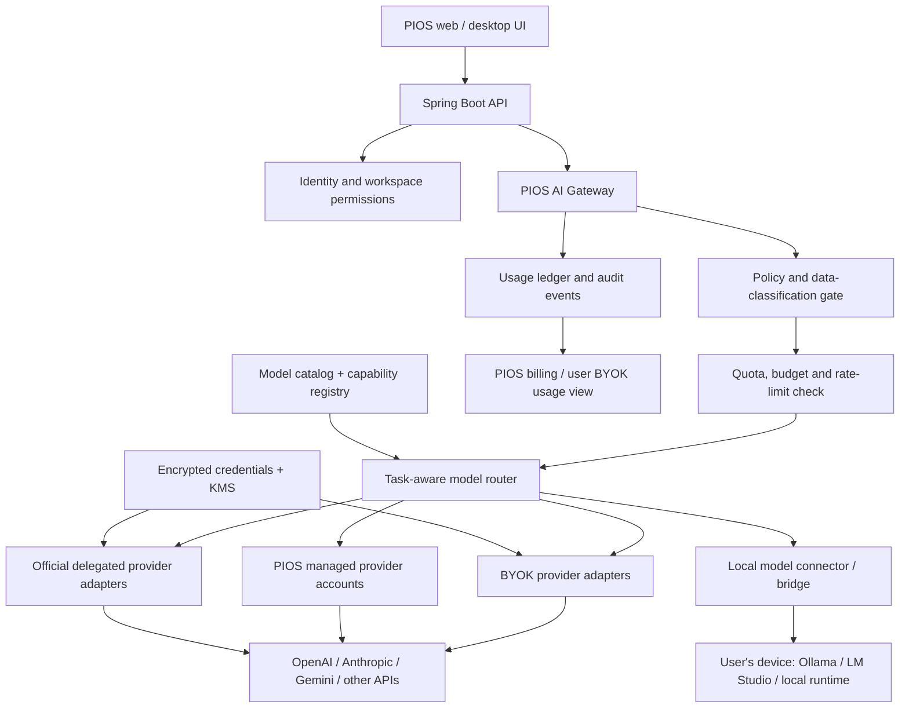

# PIOS AI Connect — Provider-Agnostic AI Architecture

**Status:** Proposed product and backend architecture for V1/V1.5  
**Scope:** Cloud BYOK, local models, PIOS-managed inference, official delegated account connections where supported, and task-level routing.

## 1. Product objective

PIOS must not require every user to consume inference from one AI vendor or from PIOS-owned model accounts. Users choose the source of inference and who receives the provider bill:

1. **Bring Your Own Key (BYOK):** user supplies a developer API credential and is billed by that provider.
2. **Local inference:** user runs a model through Ollama, LM Studio or another supported local server. Hardware and electricity are the user's cost; no model-provider inference bill is incurred for a fully local stack.
3. **PIOS-managed AI:** PIOS supplies one or more model-provider accounts and charges the user through credits, a quota or metered plan. PIOS bears the upstream provider invoice and must meter and price usage transparently.
4. **Official delegated account / linked credits:** only when the vendor publishes and permits a supported OAuth/delegated connection or account-linked API-credit mechanism. This is provider-specific, not a generic way to reuse consumer chat subscriptions.

The user's notes, sources, learning graph and projects remain in PIOS. The selected provider is an interchangeable inference engine, subject to the user's privacy policy and data permissions.

## 2. Critical subscription rule

Do not advertise “connect ChatGPT Plus / Claude Pro / Gemini Advanced and use that subscription in PIOS” as a universal capability.

- OpenAI documents separate ChatGPT and API billing. Some eligible ChatGPT plans can claim a linked API-credit benefit, but API billing remains a separate system.
- Anthropic states that Claude Pro does not include Console API usage. Other plan tiers may have distinct monthly API-credit offers and eligibility rules.
- Gemini API access uses API keys associated with a Google project and its API usage/billing tier. A Google AI consumer plan is not, by itself, a generic API key for an arbitrary third-party app.

Implementation consequence: account linking must be an explicit provider adapter with a documented and permitted grant type. If no supported grant exists, PIOS asks for a developer API key or offers local/PIOS-managed inference. Never request the user's provider password, scrape browser cookies, impersonate a first-party web app, or reverse-engineer private endpoints.

## 3. Architecture at a glance

### Logical backend modules

- `ai.catalog`: provider catalog, model catalog, supported capabilities and feature flags.
- `ai.connections`: BYOK connection records, delegated-account connections and local runtime registrations.
- `ai.credentials`: credential validation, encryption, rotation and revocation. Never return secret material to the client.
- `ai.gateway`: common request/response contract, streaming, cancellation and provider-neutral errors.
- `ai.providers`: adapters for OpenAI-compatible, Anthropic, Gemini, Azure, Bedrock and other supported interfaces.
- `ai.local`: local runtime pairing, health checks and secure bridge transport.
- `ai.routing`: task-level route resolution, fallback rules and capability checks.
- `ai.policy`: workspace membership, data classification, provider allow-lists and locality requirements.
- `ai.usage`: token metering, cost estimation, usage ledger and idempotent charge records.
- `ai.budgets`: hard limits, warning thresholds, workspace and per-user budget policies.
- `ai.billing`: PIOS-managed credits and invoicing integration. Keep isolated from BYOK provider invoices.

Start with these packages inside the modular monolith. Do not create separate microservices solely for each provider.

## 4. Connection modes and trust boundaries

### 4.1 BYOK cloud API

1. User chooses provider and opens its developer console in a new tab to create an API key.
2. User pastes the key into a PIOS form served over HTTPS.
3. Browser submits it once to the authenticated backend over TLS.
4. Backend validates the key with a low-cost/non-billable provider operation where supported, then encrypts it using envelope encryption backed by a KMS or secret vault.
5. Database stores only a credential reference, provider metadata, masked suffix, scope, status, creation time and rotation metadata.
6. Backend uses the credential for inference. It is never returned to the client, written to logs, or stored in localStorage/sessionStorage.

Credential scopes should be workspace-level or user-level and explicitly labelled. Allow the owner to rotate, test, revoke and delete a key. Failed connection tests must not expose provider response bodies that contain secrets.

### 4.2 Local inference

Supported local runtimes can expose OpenAI-compatible or vendor-specific endpoints. Initial integrations:

- Ollama local server (`http://localhost:11434/v1` for its OpenAI-compatible interface).
- LM Studio local server (default commonly `http://localhost:1234/v1`, configurable by the user).
- Custom local endpoint that passes an explicit compatibility test.

Important deployment distinction:

- When PIOS frontend and backend both run on the user's machine, the local backend can call the local runtime.
- When PIOS is hosted in the cloud, `localhost` on the cloud server is not the user's computer. The hosted service cannot directly reach the user's Ollama/LM Studio endpoint.
- For hosted PIOS, use a signed, outbound-only PIOS Local Bridge/desktop companion installed on the user's machine. It pairs through a short-lived code, establishes an authenticated outbound TLS/WebSocket connection, and receives scoped inference jobs. Do not require users to open inbound firewall ports or expose Ollama to the public internet.
- A browser-to-localhost direct mode may be offered as an advanced same-device option, subject to browser CORS/private-network restrictions and explicit user permission. It is not the universal cloud architecture.

Privacy claim must be precise. Local model inference alone does not guarantee that all data stays local. For a fully local/private workflow, document parsing, retrieved context, embeddings, vector index, reranking, logs and model inference must also remain local. If PIOS sends retrieved passages to a cloud model, disclose that data leaves the device.

### 4.3 PIOS-managed inference

- PIOS owns and pays for upstream model API accounts.
- User is charged through a clearly disclosed subscription allowance, prepaid credits or metered usage.
- Every request is preflighted against user/workspace limits. Support per-request cost estimate when available, hard stop at budget cap, alerts, usage export and itemised usage history.
- Use provider/model-specific rate limits, tenant isolation, abuse checks and concurrency limits.
- Do not launch until PIOS has provider terms review, payment processing, tax/invoicing decisions, refund policy, abuse controls and cost-margin modelling.
- Never silently switch a BYOK request to PIOS-paid inference. A fallback across billing owners requires explicit user opt-in and an approved budget.

### 4.4 Official account connection

Treat every vendor independently. Support only a documented OAuth/delegated flow, enterprise service account, linked API credit mechanism or other integration explicitly permitted by the vendor.

Use OAuth Authorization Code + PKCE where applicable, exact redirect URI validation, `state`, least-privilege scopes, token encryption, refresh-token rotation and disconnect/revoke controls. Do not infer a user's paid tier from a successful OAuth login; query supported entitlements only where vendor APIs provide them. Where a provider has no supported delegated inference API, show “Not supported; use API key instead.”

## 5. Task-aware model routing

Do not store a single provider string as the entire AI configuration. Users may route each capability independently:

| Task | Capability required | Notes |
|---|---|---|
| Assistant chat / reasoning | Chat completion, streaming, optional tool calling | A model with tool calling is needed for actions/agents |
| Summarisation / extraction | Chat completion, structured output where possible | Apply document length and privacy policies |
| Embeddings | Embedding model and vector dimension metadata | Keep dimensions consistent within a vector space; re-embed on model change |
| Reranking | Reranker or compatible scoring endpoint | Optional V1.5 capability |
| Vision | Image input / multimodal capability | Do not route to text-only models |
| Transcription | Audio transcription capability | Optional later capability |
| Image/audio generation | Corresponding generation capability | Optional later capability |

Route resolution order:

1. Authenticate user and resolve workspace.
2. Check source-level and workspace permissions.
3. Classify request and data sensitivity.
4. Resolve task route at conversation/project/workspace/user level, using most specific allowed override.
5. Filter model catalog by required capabilities, context limit, region and policy.
6. Check provider status, quotas, budget and rate limits.
7. Invoke selected adapter and stream result.
8. Record usage, cost estimate/actual cost, provider, model, task, latency and request ID.
9. Return answer with citation metadata from PIOS retrieval, not fabricated by the model.

Fallback is disabled by default across providers or billing owners. If enabled, users choose the allowed fallback order and maximum cost. Never fallback from local-only to cloud or BYOK to PIOS-managed without explicit authorisation.

## 6. Suggested domain model

| Entity | Important fields |
|---|---|
| `AiProvider` | id, slug, displayName, adapterType, enabled, docsUrl |
| `AiModel` | id, providerId, modelKey, displayName, capabilities, contextLimit, deprecatedAt |
| `ProviderConnection` | id, workspaceId, ownerUserId, providerId, connectionMode, label, status, maskedKeySuffix, credentialRef, endpoint, createdAt, lastTestedAt |
| `ProviderDelegation` | connectionId, externalSubjectId, grantedScopes, entitlementRef, expiresAt, revokedAt |
| `LocalRuntime` | connectionId, runtimeKind, endpoint/bridgeId, discoveredModels, healthStatus, lastSeenAt |
| `AiModelRoute` | id, workspaceId, scopeType, scopeId, taskType, providerConnectionId, modelId, fallbackPolicyId |
| `AiBudgetPolicy` | id, workspaceId, ownerUserId, billingMode, period, hardLimit, warningThreshold, fallbackAllowed |
| `AiUsageRecord` | id, workspaceId, userId, requestId, providerConnectionId, modelId, taskType, inputTokens, outputTokens, estimatedCost, actualCost, currency, latencyMs, createdAt |
| `AiCreditLedgerEntry` | id, accountId, usageRecordId, type, amount, balanceAfter, idempotencyKey |
| `AiAuditEvent` | id, workspaceId, actorId, action, connectionId, metadataRedacted, createdAt |

Never put raw API keys or OAuth tokens in entity JSON, audit metadata, application logs or exception traces. Store encrypted secret references in a dedicated credential store/table with strict access controls. Usage records may contain provider/model/token/cost metadata but not prompt content by default.

## 7. Proposed REST APIs

All routes are authenticated and workspace-scoped. Final paths should align with the approved global API prefix.

- `GET /api/v1/ai/providers` — provider catalog and currently enabled connection modes.
- `GET /api/v1/ai/models?providerId=...` — model catalog and capabilities.
- `POST /api/v1/ai/connections/byok` — submit a provider key, validate and store encrypted credential reference.
- `POST /api/v1/ai/connections/local` — register local endpoint or local bridge pairing.
- `POST /api/v1/ai/connections/delegated/start` — begin provider-specific official OAuth only if enabled.
- `GET /api/v1/ai/connections/delegated/callback/{provider}` — validated OAuth callback.
- `POST /api/v1/ai/connections/{id}/test` — test credentials/runtime without returning secrets.
- `GET /api/v1/ai/connections` — list safe connection metadata only.
- `DELETE /api/v1/ai/connections/{id}` — disconnect and revoke/delete credentials.
- `PATCH /api/v1/ai/routes` — set task-level routing preferences.
- `GET /api/v1/ai/routes` — list route configuration.
- `GET /api/v1/ai/usage` — usage and billing-source breakdown.
- `GET /api/v1/ai/budget` / `PUT /api/v1/ai/budget` — inspect and update budget policy.
- `POST /api/v1/ai/requests` — internal gateway entry point for AI tasks; normally called by assistant/learning/ingestion services, not exposed as an unrestricted proxy.

Do not expose a general-purpose public proxy that accepts arbitrary provider URLs and forwards user traffic.

## 8. Security requirements

- TLS for all credential submission and inference traffic.
- Encrypt credentials at rest with envelope encryption and KMS/vault key rotation.
- Secret masking, structured-log redaction, no request/response body logging by default.
- Per-workspace authorization on connection records, routes, budgets and usage history.
- Audit create/test/rotate/revoke actions, without storing secret values.
- Use short-lived OAuth state and PKCE, exact redirect allowlists, refresh-token rotation and scope minimisation.
- Validate provider endpoints. Protect against SSRF, DNS rebinding and access to cloud metadata/private network addresses. Local runtimes are accessed only through a trusted local bridge or explicit same-device connector, not arbitrary backend fetches.
- Apply model input/output limits, timeouts, concurrency caps and provider-specific rate-limit handling.
- Prevent cross-tenant prompt/context leakage. Retrieve only authorised passages before making an inference call.
- Do not silently transmit private notes/documents to a remote model. Show the route/provider and respect local-only policy.
- Add disconnect that revokes tokens where supported and deletes encrypted credentials.
- Support key rotation and incident response for leaked credentials.

## 9. Billing and cost ownership

Keep three accounting domains distinct:

1. **BYOK:** provider bills the user. PIOS shows usage metadata where obtainable, but must not claim an exact bill unless the provider API returns it.
2. **Local:** no provider inference billing for local execution. PIOS may charge for its own subscription/features, but must not label this as model usage.
3. **PIOS-managed:** provider bills PIOS; PIOS applies its published pricing/credits to the user's account. Record upstream cost and customer charge separately to calculate gross margin.

Each AI response should be traceable to a `requestId`, provider connection, model, task and billing mode. Estimate costs before high-token jobs where possible. Enforce a hard cap before submission, not after the provider has charged PIOS.

## 10. Delivery plan

### Phase A — Frontend UX prototype
- Add AI Providers page.
- Explain BYOK, local, PIOS-managed and official delegated connections.
- Show provider catalog and connection forms.
- Show task routing controls and budget settings.
- Do not persist secrets or claim that a demo connection is live.

### Phase B — BYOK foundation (first production path)
- Build provider/model catalog and adapter abstraction.
- Implement encrypted secret storage, connection test, rotate and disconnect.
- Start with one cloud provider, then add a second adapter after test coverage exists.
- Add chat route and usage metadata.

### Phase C — Local models
- Implement local runtime discovery and health checks.
- Support Ollama and LM Studio in same-device/local-backend deployments.
- Design and threat-model Local Bridge for cloud PIOS before launch.
- Add a local-only policy that includes embeddings and retrieval, not only generation.

### Phase D — Task routing and metering
- Add route registry and capability validation.
- Add embedding model configuration separately from chat models.
- Add budgets, alerts, cost attribution and route decision logs.

### Phase E — PIOS-managed AI
- Complete provider terms, payment/tax, pricing, abuse, quotas and refund review.
- Add credits ledger, preflight estimates, hard caps and reconciled usage.

### Phase F — Provider account linking
- Add only vendor-approved delegated flows and entitlement checks after each provider's terms/API support are reviewed.

## 11. Acceptance criteria

- User can register a BYOK API credential without the secret being returned or logged.
- User can test, rotate and revoke a BYOK connection.
- User can register a same-device local runtime; hosted mode clearly explains Local Bridge requirement.
- User can select different models for chat, summaries, embeddings and vision.
- Router rejects a task when the selected model lacks the required capability.
- Local-only policy never falls back to a cloud model.
- BYOK requests never silently consume PIOS credits.
- PIOS-managed requests are blocked before provider invocation when the user's budget is exhausted.
- User can see the provider, model, task, billing mode and usage for each request.
- Disconnect deletes/revokes secrets and access grants where supported.
- No UI claims a connection works before backend verification.

## 12. Official vendor references to re-check during implementation

Provider entitlements, OAuth support, API capabilities and billing policies change. Re-verify these before implementing each adapter:

- OpenAI ChatGPT/API billing separation: https://help.openai.com/en/articles/9039756-managing-billing-for-chatgpt-and-the-api-platform
- OpenAI eligible subscription API-credit benefit: https://help.openai.com/en/articles/20001626-api-credits-benefit-for-eligible-chatgpt-subscriptions
- Anthropic Claude Pro vs API Console: https://support.anthropic.com/en/articles/9876003-i-subscribe-to-a-paid-claude-ai-plan-why-do-i-have-to-pay-separately-for-api-usage-on-console
- Anthropic API credit billing: https://support.claude.com/en/articles/8977456-how-do-i-pay-for-my-claude-api-usage
- Gemini API billing: https://ai.google.dev/gemini-api/docs/billing/
- Gemini API key requirements: https://ai.google.dev/gemini-api/docs/api-key
- Ollama local and cloud API endpoints: https://github.com/ollama/ollama/blob/main/docs/api/introduction.mdx
- LM Studio local API server: https://lmstudio.ai/docs/developer/core/server

These links are implementation references, not a guarantee that a given consumer subscription can be used in PIOS.
